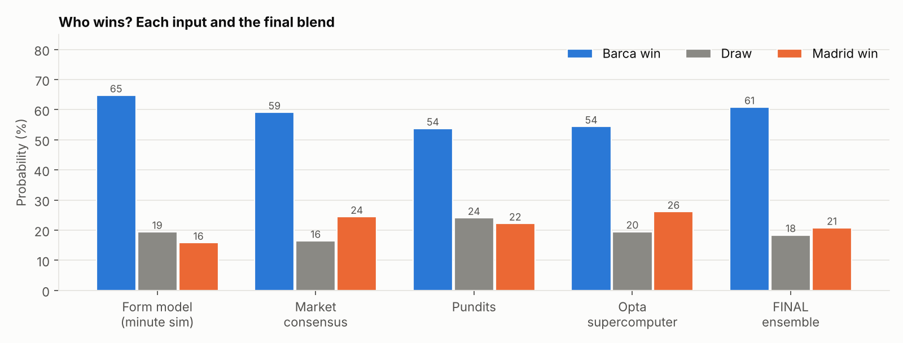
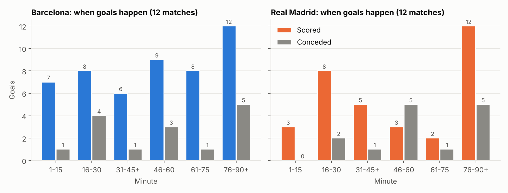
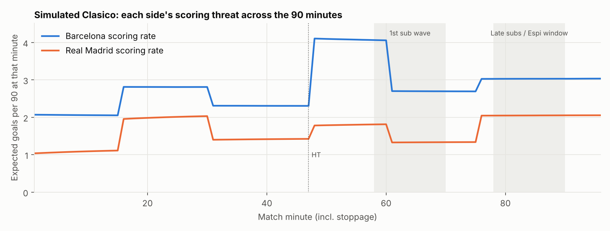
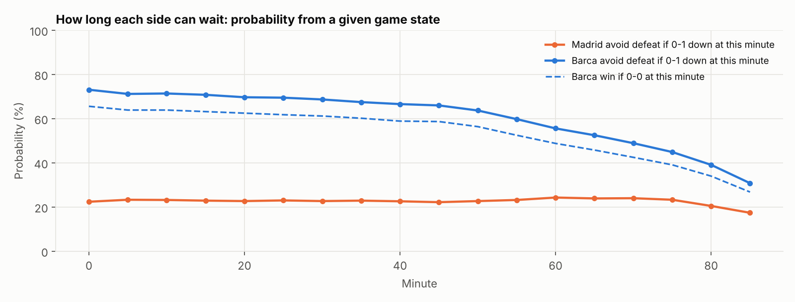
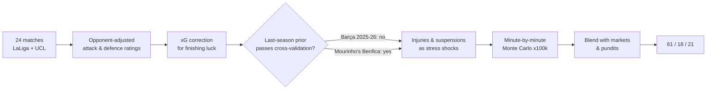

# ⚽ El Clásico Forecast: Barcelona vs Real Madrid

**LaLiga Matchday 10 · Spotify Camp Nou · Sunday 25 October 2026**

A fun side project that borrows the toolkit from my [Canadian exporter credit-risk engine](https://github.com/baddouyousuf-gif/canadian-exporter-credit-risk) (structural model, Bayesian shrinkage, stress overlays, Monte Carlo, model-vs-market comparison) and points it at football's biggest fixture.

> 📄 **Full interactive report:** open [`El_Clasico_Forecast_Report.html`](El_Clasico_Forecast_Report.html) in a browser (or via GitHub Pages: *add your Pages link here*).

---

## The prediction

| | 🔵🔴 Barça | Draw | ⚪ Madrid |
|---|:---:|:---:|:---:|
| **Final forecast** | **61%** | **18%** | **21%** |
| My model (form + minute-by-minute simulation) | 65% | 19% | 16% |
| Betting markets (5 sources, margin removed) | 59% | 16% | 24% |
| Pundits (16 published picks) | 54% | 24% | 22% |
| *Opta supercomputer (for reference)* | *54%* | *20%* | *26%* |

**Expected goals:** Barça 3.0, Madrid 1.7 · **Most likely score:** 2-1 (8%), then 3-1, 3-2, 2-2 · **Over 2.5 goals:** 85% · **Both teams score:** 81%



---

## The qualitative picture: how both teams are actually playing

Numbers only go so far, so I spent most of the research time on context: match reports, press conferences, injury news and pundit analysis from ESPN, CBS Golazo, Opta/The Analyst, Sports Mole, Goal, SI and others.

### 🔵🔴 Barcelona (Hansi Flick): a scoring machine with a back four held together by tape
- **9 wins from 9 in LaLiga** with 39 goals, the second-best start in league history. They've scored 50 goals in 12 games across all competitions.
- **Raphinha** leads LaLiga with 12 league goals. **Lamine Yamal** has 8 goals and 6 assists, and more goal involvements since 31 August than anyone in Europe's top five leagues.
- They keep about 70% of the ball and play a very high defensive line.
- **The weakness is the back four.** Koundé, Eric García and Christensen are all injured, so Barça have used **10 different back fours in 12 games**. They concede from headers, set pieces and individual mistakes.
- They lost 4-2 at PSG on Tuesday after giving up two goals in the last 10 minutes. Flick: *"We have to defend better than we did in Paris."*
- Rodri was rested for that game with the Clásico in mind.

### ⚪ Real Madrid (José Mourinho): pragmatic, dangerous late, and without Vinícius
- **Four straight wins and 12 goals in the last three**, including a comeback from 3-1 down to win 4-3 at Roma.
- **Mbappé** has 12 goals this season, and 12 in his 10 career games against Barça.
- **Shape:** a 4-2-3-1 built to counter. The plan is to hit Barça's high line with balls in behind for Mbappé, with **Yan Diomande** (3 goals in his last 4 games) attacking the left channel.
- **Set pieces are a real weapon.** All three of the late goals at Roma came from corner sequences, and Flick called Madrid "one of the best teams on set pieces."
- **The Vinícius situation.** Mourinho benched him against Villarreal to "protect" him after a slow start (1 goal, 3 assists in 11 games). He came on at half-time, had a goal disallowed for pulling an opponent's hair, and was sent off. He's now serving a **4-match ban** and misses this game.
- **Weaknesses:** no away clean sheet this season, and no clean sheet in their last **12** Clásicos.

### 🗣️ What the experts say
- **13 of 16 pundits pick Barça, 3 pick a draw, and none pick Madrid.**
- **Troy Deeney (CBS Golazo):** *"It is impossible for them to beat Barcelona... a team full of individuals against the best team."*
- **Jamie Carragher:** says Madrid *"could well lose to Barcelona and then lose the La Liga title."*
- **Luis Figo:** predicts **2-2**, because Madrid will get chances on the counter.
- **Betting markets:** Barça's price has drifted from 66% to 59.5% since the PSG loss and Madrid's win over Leipzig. The markets also expect about 4.5 total goals.

---

## ⏱️ The minute-by-minute analysis

This is the part I'm proudest of. Instead of only asking "who's better?", the model asks **when** each team is dangerous, **how they react** to the score, and **what changes when the substitutes come on**.

### Step 1: Build a goal-by-goal log
I logged every goal from all **24 matches** this season (12 per team, LaLiga and Champions League only). Each goal has its **minute, scorer, and whether the scorer came off the bench**, alongside a log of **when each coach made his substitutions**. Every match total was checked against the official scorelines. The data is in [`data/goal_events.csv`](data/goal_events.csv) and [`data/substitutions.csv`](data/substitutions.csv).

### Step 2: When do the goals happen?



| Minutes | 1-15 | 16-30 | 31-45+ | 46-60 | 61-75 | 76-90+ |
|---|:-:|:-:|:-:|:-:|:-:|:-:|
| Barça scored | 7 | 8 | 6 | 9 | 8 | 12 |
| Barça conceded | 1 | 4 | 1 | 3 | 1 | 5 |
| Madrid scored | 3 | 8 | 5 | 3 | 2 | **12** |
| Madrid conceded | 0 | 2 | 1 | **5** | 1 | 5 |

- **Madrid are a late-game team.** 36% of their goals come after the 75th minute, versus about 20% in a typical league season, and **6 of their 33 goals came from substitutes** (Espí 3, Endrick, Güler, Diomande).
- **Madrid's weak spot is early in the second half.** 5 of their 14 goals conceded came between the 46th and 60th minutes.
- **Barça score at a steady rate all game** and concede most often at 16-30' and 76-90'.

### Step 3: How does the score change their behaviour? (game state)
I tracked every minute each team spent **leading, level or trailing** and measured their scoring rate in each state.

- Barça have led for **72% of all their minutes** this season.
- When they trail, they score at about **7 goals per 90 minutes**. The sample is small, so the model shrinks this toward typical league effects.

### Step 4: Does momentum exist?
I checked every pair of goals scored within 10 minutes of each other. If momentum were real, the second goal would usually go to the team that scored the first. It went to that team **55%** of the time, *less* than the 62% you'd expect from scoring rates alone. **Goals get answered, not compounded**, so the model applies no "hot streak" bonus.

- **Barça reply fast:** 12 of the 15 goals they conceded were answered within 15 minutes (median 10 minutes).
- **Madrid reply late:** only 4 of 14 were answered within 15 minutes (median 22 minutes). Their replies arrive once Mourinho's substitutes come on.

### Step 5: Simulate the Clásico minute by minute
The model plays the match **100,000 times, one minute at a time**. Each minute, each team's chance of scoring depends on four things:
1. **Its own scoring-time profile and the opponent's conceding-time profile.** For example, Barça's threat peaks at 46-60', which is exactly when Madrid concede most.
2. **The current score.** A trailing team pushes harder; a leading team eases off.
3. **Red cards**, with Madrid's risk set higher (two reds already this season).
4. **Stoppage time.**



### Step 6: How long can each team wait?
The simulation can be started from any minute and any score, which turns it into an in-play model:



- **0-0 at half-time:** Barça still win 59% of the time.
- **0-0 after 75 minutes:** a draw becomes the most likely result (43%).
- **Madrid 1-0 up:** they only become favourites if they hold the lead until about **70 minutes**. That's the window Mourinho has to survive.
- **Barça 1-0 up:** close to decisive at almost any minute (about 76-83%).
- **The first goal is huge.** If Barça score first they win 77%; if Madrid score first it's close to even (44 / 25 / 31).

---

## 🧮 How the model works



| Step | What it does | Credit-risk analogy |
|---|---|---|
| Ratings | Goals scored and conceded, adjusted for opponent strength and home/away, with recent games weighted more heavily | Obligor scoring |
| xG correction | Pulls goals back toward expected goals (Barça are outscoring their xG) | Filtering out noise |
| Prior test | Only uses last season if it improves **leave-one-out** predictions | Out-of-sample validation |
| Availability shocks | Barça's defence weakened ×1.06, Madrid's attack ×0.97 (no Vinícius), etc. | Stress overlays |
| Minute-by-minute simulation | Timing profiles, game state, red cards, 100,000 runs | Path-dependent Monte Carlo |
| Blend | 50% market, 40% model, 10% pundits | Model PD vs market-implied PD |

**Did last season help?** Each match this season was predicted from the other 23 games, both with and without last season's data:
- **Flick's 2025-26 Barça made the predictions worse**, so it was dropped. This season's team is simply better.
- **Mourinho's 2025-26 Benfica improved the predictions**, so it was kept at a conservative weight. Mourinho's defensive identity carries over.

---

## 📁 Repo structure
```
├── El_Clasico_Forecast_Report.html   # full report, charts embedded
├── data/
│   ├── matches_2026_27.csv           # all 24 matches
│   ├── goal_events.csv               # every goal: minute, scorer, off the bench?
│   ├── substitutions.csv             # sub timings
│   ├── squads_availability.csv       # squads, injuries, suspensions, projected XIs
│   ├── expert_predictions.csv        # pundit picks with source links
│   ├── market_and_model_probabilities.csv
│   ├── league_table_md9.csv
│   └── priors_2025_26.csv
├── model/
│   ├── clasico_model_v2.py           # the engine
│   ├── charts.py
│   ├── build_report.py
│   └── clasico_model_v1.py           # first quick version
└── outputs/                          # results.json, in-play scenarios, charts
```

## ▶️ Run it yourself
```bash
pip install numpy scipy pandas matplotlib
cd model
python clasico_model_v2.py && python charts.py && python build_report.py
```
When the confirmed line-ups come out, tweak `SHOCKS` at the top of `clasico_model_v2.py` and re-run.

## ⚠️ Limitations
- **Small samples:** 12 matches per team. A few goal minutes and substitution times are approximate and flagged in the data.
- **Judgment calls:** Champions League opponent strengths, home advantage and the injury shocks are my estimates. The report includes a sensitivity table showing how much each one matters.
- **Not covered:** TikTok and Instagram creator predictions weren't included.
- **Just for fun:** this is a probabilistic forecast, not betting advice.

## Sources
UEFA · LaLiga · Sky Sports · OddAlerts (xG) · VAVEL, Flashscore, Fox Sports and Football Web Pages match reports · Al Jazeera · ESPN · The Analyst/Opta · Goal · CBS Sports Golazo (via Goal/AS) · Sports Mole · Rotowire · Sports Illustrated · The False 9 · TWSN · Covers/Kalshi · VSiN · Polymarket (via CryptoSlate) · Managing Madrid · FC Barcelona · Ovación. Every link is in the CSVs in `data/`.

---
*Built by Yousuf Baddou · Economics & Political Science, Carleton University*
